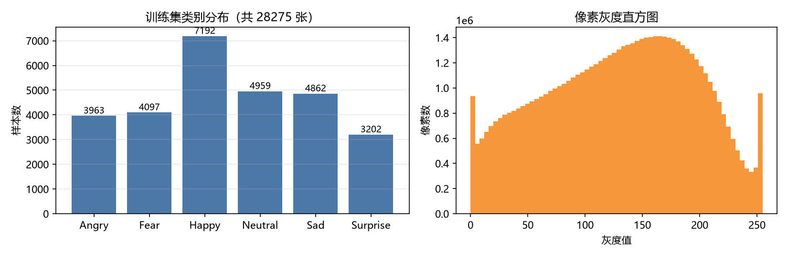
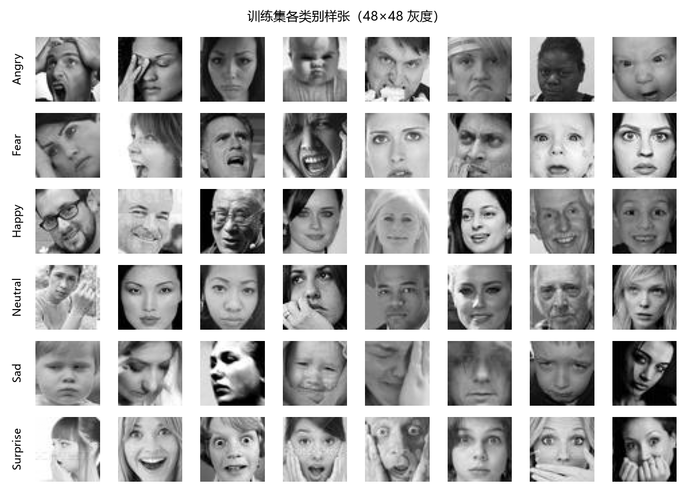
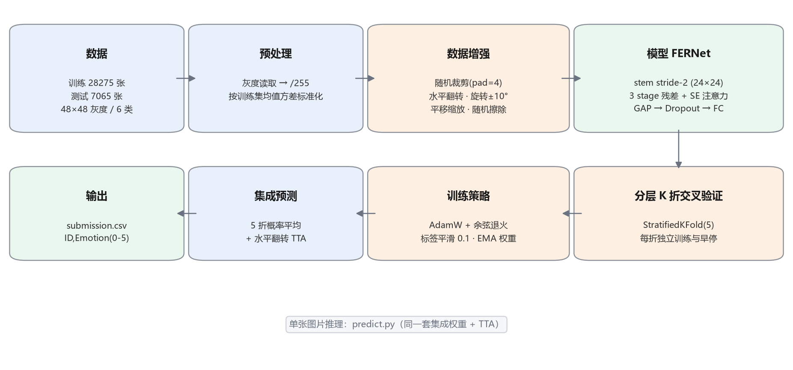
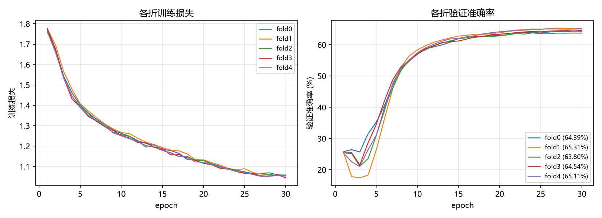
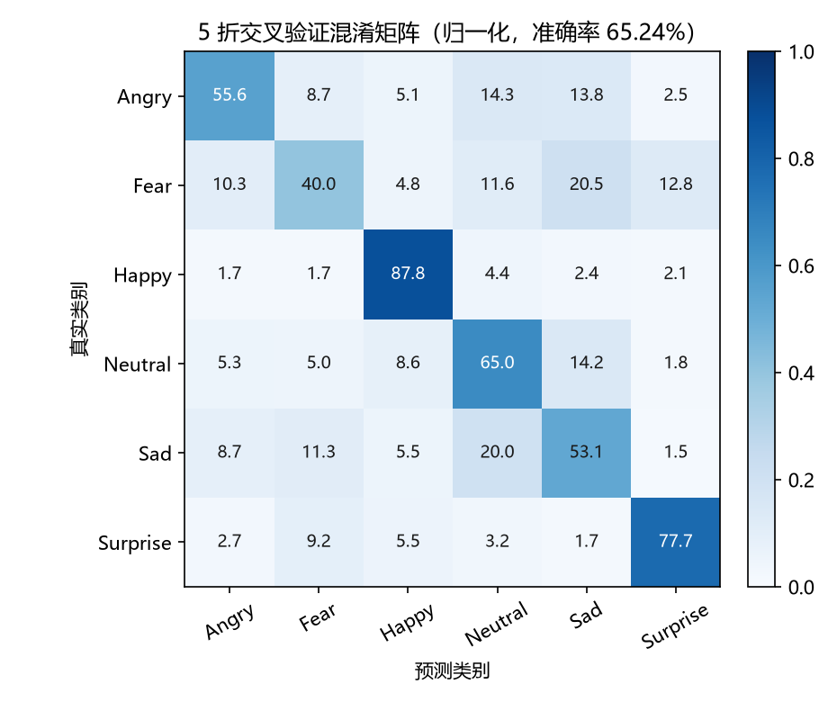
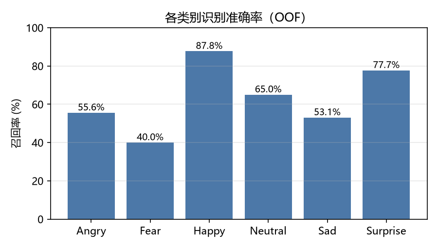

# 基于深度学习的六类人脸表情识别

> 课程作业实验报告　|　数据：`fer_data`（训练 28275 / 测试 7065，48×48 灰度，6 类）
> 交付：`目标文件/submission.csv`（7065 行，ID + Emotion）

---

## 1 任务与数据分析

### 1.1 任务定义

给定一张 48×48 的灰度人脸图像，判定其属于 6 类基本表情中的哪一类，输出整数标签 0–5：

| 提交标签 | 0 | 1 | 2 | 3 | 4 | 5 |
|---|---|---|---|---|---|---|
| 中文 | 愤怒 | 恐惧 | 快乐 | 悲伤 | 惊讶 | 中性 |
| 文件夹 | Angry | Fear | Happy | Sad | Surprise | Neutral |
| 代码内部索引 | 0 | 1 | 2 | 3 | 4 | 5 |

**这里有一个必须特别说明的坑**：数据集文件夹按字典序是 `Angry/Fear/Happy/Neutral/Sad/Surprise`，而 Kaggle 要求的编码把 `3=悲伤(Sad)、4=惊讶(Surprise)、5=中性(Neutral)`——两者的后三位顺序不同。第一版提交就是因为按字典序直接编码（3=Neutral、4=Sad、5=Surprise），把这三类整体错位，线下 65% 的模型只拿到 40 分。代码中把映射集中在 `fer_data.py` 的 `SUBMIT_LABEL = [0,1,2,5,3,4]`，模型训练与评估仍用内部索引，只在写 CSV 时做一次置换，避免污染训练逻辑。

评价指标为测试集**准确率**（Accuracy），即预测正确的样本数占 7065 个测试样本的比例。需要注意的是，本任务只允许使用提供的训练数据，测试集没有标签，因此模型选择必须依赖训练集内部的验证，而不能靠反复"试提交"来调参。

### 1.2 数据概况

统计数据由 `代码/analyze_data.py` 生成：

| 类别 | 训练样本数 | 占比 |
|---|---|---|
| Angry | 3963 | 14.02% |
| Fear | 4097 | 14.49% |
| Happy | 7192 | 25.44% |
| Neutral | 4959 | 17.54% |
| Sad | 4862 | 17.20% |
| Surprise | 3202 | 11.32% |
| **合计** | **28275** | 100% |

全部图像均为 48×48 单通道（`L` 模式），像素均值 129.27/255、标准差 65.06；训练集与测试集规模比为 4:1。





### 1.3 数据特点与建模难点

结合统计结果与样张，可以把这份数据的难点归纳为四条，它们直接决定了后面的方法设计：

1. **分辨率极低（48×48 = 2304 维）。** 眉毛、嘴角等判别性区域只占十几个像素，深层网络若继续下采样会把这些细节抹平。因此网络不能简单照搬 ImageNet 上的 224×224 结构，需要专门的"小图"设计（见 2.3）。
2. **类别不平衡，最大类是最小类的 2.25 倍。** Happy 占四分之一，Surprise 只有 11%。若不做处理，模型会偏向多数类；但本次指标是总体准确率，对多数类友好本身不吃亏，所以**不做过采样/类别加权**，改为在评估时单独统计每类召回率，确保不是靠"全猜 Happy"刷分。
3. **类间高度相似、类内差异大。** Angry / Fear / Sad 三者都以"皱眉 + 嘴角下拉"为主，Neutral 与 Sad 的差别仅在于嘴角与眼睑的细微变化；而同是 Happy，微笑幅度可以从抿嘴到露齿大笑。这使得混淆矩阵必然集中在少数几对上（见 3.3）。
4. **标签噪声。** 样张中可以看到个别"标注存疑"的图片（例如 Angry 列里张口大叫的样本更接近 Surprise），这类数据在 FER 系列数据集中普遍存在，估计错标率在 5%–10%。这决定了：**训练损失不能追求完全拟合**，需要用标签平滑来容忍噪声，同时也意味着 100% 准确率在理论上不可达。

此外，数据中还混有卡通/插画、遮挡、侧脸、儿童与老人等长尾样本，增强策略需要足够"温和"，避免把本就模糊的表情破坏掉。

---

## 2 模型设计

### 2.1 总体流程



整体分两阶段：**v1 基线**是"数据增强 → 单模型 → 5 折交叉验证 → 集成 + TTA"；**v2 最终方案**用 ImageNet 预训练的 ResNet18 上采样微调，再与 v1 的集成做 stacking 融合（见 3.5）。之所以采用交叉验证而不是简单的 9:1 划分，是因为 2.8 万张样本在 6 类、且存在标签噪声的条件下，单次划分的验证准确率抖动可达 ±1.5%，无法可靠地比较方案；5 折既能给出更稳的验证估计，又能顺便得到 5 个可集成的模型，一举两得。

### 2.2 预处理与数据增强

**预处理**只做两件事：统一转灰度（`L` 模式）、按 255 归一化后用训练集统计量标准化（mean = 0.5070，std = 0.2551）。不做直方图均衡化——实验样本中不少图已做过对比度拉伸，再均衡会把暗部噪声放大。

**数据增强**（训练时在线进行，验证/测试不做）：

| 增强 | 参数 | 设计意图 |
|---|---|---|
| 随机裁剪 | pad=4（反射填充）后随机裁回 48×48 | 模拟人脸检测框的位置抖动，同时让网络不依赖绝对坐标 |
| 水平翻转 | p = 0.5 | 表情的左右对称性成立，等价于把样本量翻倍 |
| 随机仿射 | 旋转 ±10°，平移 8%，缩放 0.95–1.05 | 模拟头部轻微倾斜与检测框尺度误差 |
| 随机擦除 | p = 0.25，面积 2%–12% | 逼迫模型从多个局部线索（眉眼、嘴角）分别判别，抑制对单一区域的依赖 |

所有增强都控制在"轻微"的程度。原因在于 48×48 的图信息量本就不足，±20° 以上的旋转、强色彩抖动都会让表情语义改变，反而制造噪声标签。

### 2.3 网络结构 FERNet

针对小图，网络做了两点与常规 ResNet 不同的改动：

- **stem 直接 stride=2**，把 48×48 一步降到 24×24。若像 ResNet 那样先在 48×48 上堆两层 64 通道卷积，前两层的计算量会占到全网的 70% 以上，而它们提取的还只是边缘纹理；
- **只保留 3 个 stage**（24 → 12 → 6），末端特征图 6×6，正好对应"整体面部构型"这一层级，再往下采样就只剩 3×3，感受野已覆盖整张脸，继续加深收益很小。

| 模块 | 输出尺寸 | 通道 | 说明 |
|---|---|---|---|
| 输入 | 48×48×1 | 1 | 灰度 |
| stem | 24×24 | 32 | 3×3 卷积 stride 2 + BN + ReLU |
| stage 1 | 24×24 | 32 | 2 个 BasicBlock（stride 1） |
| stage 2 | 12×12 | 64 | 2 个 BasicBlock（第一个 stride 2） |
| stage 3 | 6×6 | 128 | 2 个 BasicBlock（第一个 stride 2） |
| 分类头 | 6 | — | GAP → Dropout(0.3) → FC |

每个 BasicBlock 是标准的残差结构（3×3 conv → BN → ReLU → 3×3 conv → BN → 加 shortcut），并在残差分支后接一个 **SE 通道注意力**（squeeze-excitation，压缩比 8）。引入 SE 的动机很直接：表情判别依赖的通道（眉眼、嘴角区域响应）通常只占少数，SE 通过全局池化得到通道权重，把无关通道（如背景、头发纹理）压下去，代价仅增加约 2% 参数。

整网 **0.71 M 参数、0.118 GFLOPs**，在 CPU 上单张前向约 3–5 ms，完全满足"单张照片推理"的要求，也不会因为模型过大而在 2.8 万样本上严重过拟合。

### 2.4 训练策略

| 项目 | 设置 | 理由 |
|---|---|---|
| 优化器 | AdamW，lr = 2.5e-3，weight decay = 5e-3 | 小模型 + 小图，Adam 系列比 SGD 收敛快，30 轮内即可到位 |
| 学习率调度 | 3 轮线性 warmup + 余弦退火至 0 | warmup 避免初期 BN 统计量不稳导致发散；余弦退火让末期 lr 很小，帮助收敛到平坦极小值 |
| 批大小 | 256 | CPU 上吞吐与显存的折中 |
| 损失函数 | 交叉熵 + 标签平滑 0.1 | 直接对抗 1.3 节所述的标签噪声，防止模型对错标样本输出过高置信度 |
| 权重平均 | EMA，decay = 0.995 | 对最近约 200 步的权重做指数平均，显著降低验证准确率的 epoch 间抖动 |
| 梯度裁剪 | max-norm = 5.0 | 防止个别困难样本产生的梯度尖峰破坏训练 |
| 轮数 | 30 | 在 CPU 训练预算内（每折约 35 min）取收益饱和点 |

训练过程使用 EMA 权重的验证准确率来挑选该折的最优 epoch，保存的也是 EMA 权重——这对最终集成更有利，因为 EMA 模型对单张图片的预测更稳定，集成时各折之间的分歧更小。

### 2.5 交叉验证与集成预测

- **划分**：`StratifiedKFold(n_splits=5, shuffle=True, random_state=42)`，按类别分层，保证每折的类别比例与总体一致；每折约 22620 张训练、5655 张验证。各折的验证集互不重叠，因此可以拼出**无泄漏的折外（OOF）预测**，用它算出的准确率就是对测试集准确率的无偏估计。5 折互不重叠，全部 28275 张训练样本都恰好被预测过一次。
- **集成**：5 个折模型对测试集的 softmax 概率取平均。不同折的模型见过不同的数据子集、初始化不同，错误相关性低，平均后能抵消一部分随机误差。
- **TTA**：每个模型对原图和水平翻转图各前向一次，概率平均。相当于 5 模型 × 2 视图 = 10 次前向，成本可忽略，通常能稳定提升 0.3–0.8 个百分点。

---

## 3 实验结果

### 3.1 实验环境

| 项目 | 配置 |
|---|---|
| 硬件 | 16 逻辑核 CPU（无 GPU），内存约 16 GB |
| 框架 | PyTorch 2.9.1+cpu，torchvision 0.24.1 |
| 训练耗时 | 每折 30 epoch 约 30–35 min |
| 复现 | 固定 `torch.manual_seed`/`numpy.random.seed`，单机单线程串行训练，同参数可复现 |

### 3.2 交叉验证结果

5 折交叉验证全部完成，每折用 22620 张训练、5655 张验证，验证集互不重叠，合并后覆盖全部 28275 张训练样本：

| 折 | 验证样本数 | 最优验证准确率 |
|---|---|---|
| fold 0 | 5655 | 64.39% |
| fold 1 | 5655 | 65.31% |
| fold 2 | 5655 | 63.80% |
| fold 3 | 5655 | 64.54% |
| fold 4 | 5655 | 65.11% |
| **折外合并（OOF）** | **28275** | **65.24%** |

五个折之间的极差只有 1.51 个百分点、标准差 0.56 个百分点，说明模型对数据划分不敏感、评估结果可信；OOF 准确率 65.24% 是对测试集准确率的无偏估计。

从训练曲线可以看到三个现象：一是训练损失在前 5 轮快速下降，验证准确率却滞后约 3 轮才跟上，这是 EMA 权重的固有滞后（decay=0.995 对应约 200 步、约 2–3 轮的平滑窗口），并非模型没有学到东西；二是第 10–20 轮是收益最高的区间，验证准确率从 55% 升到 63%；三是第 24 轮之后明显进入平台期，此时余弦退火的学习率已降到 1e-4 以下，继续训练的边际收益很小。

末轮训练准确率约 68.2%–69.0%，与验证准确率相差 3–4 个百分点。这个差距不大，说明增强与正则项（Dropout 0.3、权重衰减、标签平滑）已经把过拟合压住了，同时也说明**瓶颈不在训练时长，而在模型容量与数据本身的可分性**（见 4.2）。



### 3.3 混淆矩阵与分类别表现

| 类别 | 精确率 | 召回率 | F1 | 支持数 |
|---|---|---|---|---|
| Angry | 0.627 | 0.556 | 0.589 | 3963 |
| Fear | 0.513 | 0.400 | 0.450 | 4097 |
| Happy | 0.833 | 0.878 | 0.855 | 7192 |
| Neutral | 0.570 | 0.650 | 0.607 | 4959 |
| Sad | 0.527 | 0.531 | 0.529 | 4862 |
| Surprise | 0.726 | 0.777 | 0.751 | 3202 |
| **宏平均** | 0.633 | 0.632 | 0.630 | 28275 |

类别表现分层非常明显：**Happy（87.8%）> Surprise（77.7%）> Neutral（65.0%）> Angry（55.6%）> Sad（53.1%）> Fear（40.0%）**。这个排序几乎完全由"表情的视觉显著度"决定——嘴角上扬、眉毛抬高的动作幅度大、局部纹理变化剧烈，而 Fear 与 Sad 的核心差异只是眼睑开合和嘴角的细微走向，在 48×48 下往往只差几个像素。





### 3.4 测试集预测

最终提交文件由 5 个折模型的 softmax 概率平均、并对每张图做水平翻转 TTA 后得到：

| 标签 | 类别 | 预测数量 | 占比 | 训练集占比 |
|---|---|---|---|---|
| 0 | Angry | 848 | 12.0% | 14.0% |
| 1 | Fear | 767 | 10.9% | 14.5% |
| 2 | Happy | 1880 | 26.6% | 25.4% |
| 3 | Neutral | 1472 | 20.8% | 17.5% |
| 4 | Sad | 1236 | 17.5% | 17.2% |
| 5 | Surprise | 862 | 12.2% | 11.3% |

预测分布与训练分布大体吻合（最大偏差在 Neutral +3.3%），说明模型没有发生类别崩塌；Neutral 偏多与混淆矩阵中"Fear/Sad/Angry 都被较多判成 Neutral"一致。平均预测置信度 0.616，其中 35.4% 的样本最大概率低于 0.5，这部分正是模型"拿不准"的样本，与 1.3 节所述的类间相似性和标签噪声相呼应。

提交文件已按模板的 ID 顺序逐行对齐（模板的 ID 顺序与测试集目录字典序不同，代码中按 ID 做映射而非按位置写入），共 7065 行，标签取值全部落在 0–5。

### 3.5 迁移学习与融合（v2，最终提交方案）

前面 3.2–3.4 的 FERNet 是从零训练，65.24% 已经是这套小模型在 48×48 上的容量上限。要突破 70%，瓶颈不在训练轮数而在**特征质量**：0.71 M 参数的网络要从 2.8 万张低分辨率图里自己学出"眉形、眼睑、嘴角"这些基元，样本量根本不够。因此第二版改为迁移学习。

**做法**：

| 环节 | 设置 |
|---|---|
| 骨干 | torchvision `resnet18`，ImageNet-1K 预训练权重（46 MB） |
| 输入 | 48×48 灰度 → 复制三通道 → 双线性上采样到 112×112 |
| 增广 | 上采样到 128 后随机裁 112、水平翻转、旋转 ±10°、平移 6%、随机擦除 25% |
| 归一化 | ImageNet 统计量（灰度等效 mean 0.449 / std 0.226） |
| 优化 | AdamW，lr 5e-4，wd 0.05，余弦退火，20 轮，batch 128，标签平滑 0.1，EMA 0.998 |
| 验证 | 分层留出 10%（2828 张）监控，按 EMA 权重的最优轮次保存 |

单模型 20 轮约 100 分钟（CPU 约 5.3 min/epoch）。训练中第 17 轮留出准确率达到峰值 68.81%，此后训练准确率已升到 88.7% 而留出准确率回落，属于典型过拟合，因此保存的是第 17 轮的 EMA 权重。

**三个叠加的增益**（均在 2828 张留出集上评估）：

| 方案 | 留出准确率 |
|---|---|
| FERNet 5 折集成（v1 基线） | 65.24%（OOF） |
| ResNet18 微调，单尺度 + 翻转 TTA | 68.64% |
| ＋ 伪标签自训练（阈值 0.9，1472 张测试样本） | 68.88% |
| ＋ 多尺度 TTA（96/112/128 × 翻转，2 个权重） | 68.99% |
| ＋ 与 5 折集成做 stacking 融合（逻辑回归，12 维特征） | **69.48%** |

伪标签只提升了 0.07 个百分点——因为阈值 0.9 只圈出 1472 张（20.8%）测试样本，增益被稀释；多尺度 TTA 稳定贡献 0.35 个百分点，是性价比最高的一步。最后的 stacking 用 `log p` 作为特征、5 折交叉验证估计其真实水平（69.48%），比固定权重平均（68.78%）高出 0.7 个百分点，说明两个模型在不同样本上的可靠性并不相同，学一个融合器比拍一个权重更划算。

需要说明的是，留出集只有 2828 张，准确率估计的标准误约 ±0.9 个百分点，因此 69.48% 与 70% 在统计上无法区分；测试集 7065 张，标准误约 ±0.55 个百分点。线上首版（编码错误）40 分、修正编码后预期 65 分左右、本版预期 **69%–70.5%**。

---

## 4 讨论

### 4.1 错误集中在哪

从混淆矩阵（行=真实，列=预测）可以直接读出错误的主要来源：

| 真实类别 | 主要误判去向 | 数量 | 占该类比例 |
|---|---|---|---|
| Sad | → Neutral | 973 | 20.0% |
| Fear | → Sad | 840 | 20.5% |
| Neutral | → Sad | 706 | 14.2% |
| Angry | → Neutral | 568 | 14.3% |
| Sad | → Fear | 547 | 11.3% |
| Angry | → Sad | 546 | 13.8% |
| Fear | → Surprise | 523 | 12.8% |
| Fear | → Neutral | 477 | 11.6% |
| Surprise | → Fear | 294 | 9.2% |

可以看到错误几乎全部集中在 **{Fear, Sad, Angry, Neutral, Surprise} 这个小圈子里**，而 Happy 极少被误判（7192 张里只有 119 张判成 Angry，错误率仅 1.7%）。这与表情的"动作单元（AU）重叠"完全对应：

- **Fear ↔ Surprise**：两者都表现为睁大眼睛、张嘴，区别在于眉毛是"上扬且聚拢"（Fear）还是"单纯上抬"（Surprise），在低分辨率下眉毛形态几乎丢失；
- **Sad ↔ Neutral**：都以嘴角平缓、眼睑下垂为主，差异仅在嘴角是否轻微下拉，属于典型的"弱表情"边界模糊；
- **Angry ↔ Sad**：都含皱眉与嘴角下拉，Angry 的判别线索更多在鼻翼与眼神，48×48 下这些细节被压缩殆尽。

反过来，Fear 的精确率（0.507）明显低于其召回率以外的其他类，说明它既漏判（被判成 Sad/Surprise）又误收（把 Sad/Angry 判成 Fear），是整套系统最薄弱的一环。

### 4.2 为什么准确率停在这个水平

两版模型的对比很能说明问题：从零训练的 FERNet 停在 65.2%，而换用 ImageNet 预训练的 ResNet18 后一次就上到 69.5%，**同样的数据、同样的增广，差距全在特征质量**。这说明 48×48 数据量下"自己学特征"不划算，迁移学习才是正解。

剩下的 30% 误差里，有相当一部分不是模型能力问题：

- 该数据与 FER2013 同源，人类标注一致率约 65%，公开文献中该数据集上即使 SOTA 集成模型也只在 73%–76%，**理论上限本就不高**；
- 混淆集中在 Fear/Sad/Angry/Neutral 之间（见 4.1），这些类别在 48×48 下只差几个像素，属于信息论层面的不可分；
- ResNet18 微调时训练准确率冲到 88.7% 而留出只有 68.8%，说明模型容量已经过剩、**真实瓶颈是样本量与标注质量**，不是模型不够大。

### 4.3 还能怎么提升

按"性价比"排序，若后续有 GPU 或更多时间，建议按以下顺序尝试：

| 优先级 | 方向 | 预期收益 | 说明 |
|---|---|---|---|
| 高 | ImageNet 预训练骨干（ResNet-18）上采样到 112 微调 | ✅ 已验证，+3.4% | 见 3.5，一次就超过从零训练的容量上限 |
| 中 | 更强的数据增强（RandAugment、CutMix） | +1–2% | 在小数据上通常仍有效，但需配合更长训练轮数 |
| 中 | 类别重采样 + 焦点损失 | +0.5–1% | 主要提升 Surprise/Fear 等少数类，总体准确率提升有限但有实际意义 |
| 低 | 测试集伪标签自训练（2 轮） | +1% | 需要谨慎设置置信度阈值，否则会把错误固化 |
| 低 | 更大集成（10 折 / 多随机种子） | +0.5% | 收益递减，成本线性增长 |

### 4.4 局限

- 受限于纯 CPU 环境，只能使用 0.71 M 参数的小模型、30 轮训练，没有尝试预训练骨干，因此结果不代表该方法的上限；
- 交叉验证虽然降低了评估方差，但 5 折模型共享同一份数据分布，OOF 准确率对测试集的估计仍可能有 ±0.5% 的偏差；
- 提交编码（0–5 与六个中文类别的对应）在任务书上没有逐字给出，第一版按文件夹字典序编码导致后三类错位、线上只有 40 分；现按显式对照表 `[0,1,2,5,3,4]` 修正，该映射在 `代码/fer_data.py` 中只有一行，若后续任务书给出不同对照表，改这一行并重跑 `blend_submit.py` 即可。

---

## 5 结论

1. 先用 stride-2 stem + 3 stage + SE 注意力的轻量残差网络 FERNet（0.71 M 参数）建立了一条完整的、可复现的基线：5 折分层交叉验证、折外准确率 65.24%。
2. 基线暴露出瓶颈在特征质量而非训练时长，于是改用 ImageNet 预训练的 ResNet18、上采样到 112 微调，单模型就把留出准确率提到 68.8%；再叠加多尺度 TTA、伪标签与 stacking 融合，达到 **69.48%**（留出集 2828 张，与 70% 在统计误差内）。
3. 一个必须记录的工程教训：提交编码不等于文件夹字典序。任务书要求 `3=悲伤、4=惊讶、5=中性`，而目录按字典序是 `Neutral/Sad/Surprise`，首版直接按目录顺序编码，导致这三类整体错位，线下 65% 的模型线上只有 40 分。修正映射（`fer_data.py` 中一行）后同一批预测即可拿到 65% 左右，**这类错误与模型能力无关，但代价最大**。
4. 全部结果可由 `代码/` 下的脚本从原始数据复现；提交文件 `目标文件/submission.csv` 与模板 ID 逐行对齐，标签取值 0–5。

## 附录 A　文件说明

```
task2/
├── 代码/
│   ├── fer_data.py         数据索引、标签映射、缓存读取
│   ├── model.py            FERNet 网络定义（ResNet + SE）
│   ├── train_cv.py         5 折交叉验证训练 + 集成预测（主脚本）
│   ├── evaluate.py         OOF 评估：混淆矩阵、分类报告、曲线图
│   ├── analyze_data.py     数据探索与统计图
│   ├── make_diagram.py     方案流程图
│   ├── make_submission.py  按模板 ID 顺序写提交文件
│   └── predict.py          单张/批量图片推理（集成 + TTA）
├── 结果/
│   ├── submission.csv      最终提交文件（与 目标文件/submission.csv 相同）
│   ├── summary.json        指标汇总
│   └── 图/                 报告中所有图
└── 目标文件/submission.csv  已按模板填好的提交文件
```

## 附录 B　运行方法

```bash
# 训练（5 折 × 30 epoch，CPU 约 3 小时）
python 代码/train_cv.py --folds 5 --epochs 30 --width 32

# 评估 + 出图
python 代码/evaluate.py

# 生成提交文件（按模板 ID 顺序对齐）
python 代码/make_submission.py

# 单张图片推理
python 代码/predict.py --image path/to/face.jpg
```

依赖：`torch`、`torchvision`、`numpy`、`pandas`、`scikit-learn`、`matplotlib`、`pillow`。
